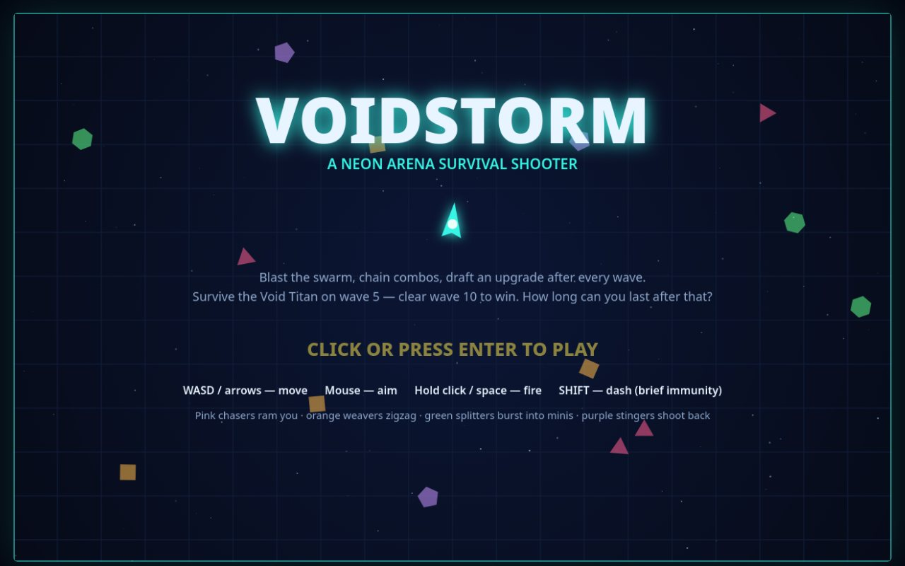
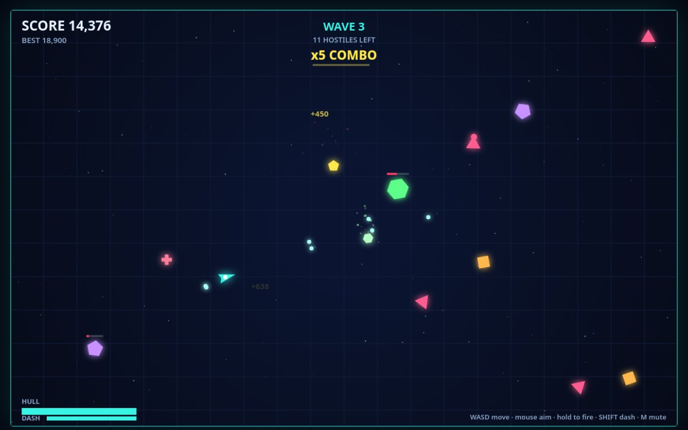

# 🌌 VOIDSTORM — Neon Arena Survival Shooter

▶️ **[Play it live](https://kamalmosadegh.github.io/voidstorm/game/)** — no install, runs in your browser.

## 🎮 The game
Survive escalating waves in a living neon arena:
- **5 enemy types + a boss**, each with its own behaviour
- Combo scoring and a **between-wave upgrade draft**
- Victory at wave 10 — then **endless mode**
- **Zero audio assets:** every sound and the whole soundtrack are synthesized live with WebAudio

## 🕹️ Controls
**WASD / arrows** move · **mouse** aim · **click / Space** fire

## 🛠️ Tech
Vanilla JavaScript + Canvas 2D · deterministic seeded runs · fixed-timestep loop · 99.7% self-authored code · passed every Round-1 validity check of the make.fun "Best Game" bounty ($1,000 pool).

## 👤 Author
**Kamal Mosadegh** — freelance developer · [Portfolio](https://kamalmosadegh.github.io) · kamalmosadegh6977@gmail.com

MIT licensed.
